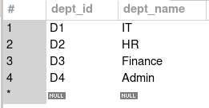
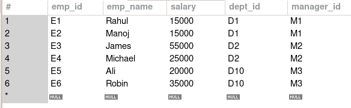
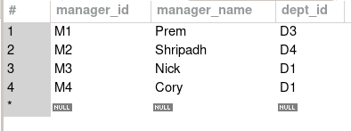
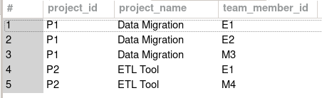

Department + employees + manager + projects
```sql
-- create databse
create database company;
use company;

-- create department tabel
CREATE TABLE department (
    dept_id VARCHAR(20) PRIMARY KEY,
    dept_name VARCHAR(50)
);

-- insert value into department tabel
INSERT INTO department VALUES 
('D1', 'IT'),
('D2', 'HR'),
('D3', 'Finance'),
('D4', 'Admin');

SELECT * FROM department;

-- create employee tabel
CREATE TABLE employee (
    emp_id VARCHAR(20) PRIMARY KEY,
    emp_name VARCHAR(50),
    salary INT,
    dept_id VARCHAR(20),
    manager_id VARCHAR(20)
);

-- insert value into employee tabel
INSERT INTO employee VALUES 
('E1', 'Rahul', 15000, 'D1', 'M1'),
('E2', 'Manoj', 15000, 'D1', 'M1'),
('E3', 'James', 55000, 'D2', 'M2'),
('E4', 'Michael', 25000, 'D2', 'M2'),
('E5', 'Ali', 20000, 'D10', 'M3'),
('E6', 'Robin', 35000, 'D10', 'M3');

SELECT * FROM employee;

-- create manager tabel
CREATE TABLE manager (
    manager_id VARCHAR(20) PRIMARY KEY,
    manager_name VARCHAR(50),
    dept_id VARCHAR(20)
);

-- insert value into manager tabel
INSERT INTO manager VALUES 
('M1', 'Prem', 'D3'),
('M2', 'Shripadh', 'D4'),
('M3', 'Nick', 'D1'),
('M4', 'Cory', 'D1');

SELECT * FROM manager;

-- create projects tabel
CREATE TABLE projects (
    project_id VARCHAR(20),
    project_name VARCHAR(100),
    team_member_id VARCHAR(20)
);

-- insert value into projects tabel
INSERT INTO projects VALUES 
('P1', 'Data Migration', 'E1'),
('P1', 'Data Migration', 'E2'),
('P1', 'Data Migration', 'M3'),
('P2', 'ETL Tool', 'E1'),
('P2', 'ETL Tool', 'M4');

SELECT * FROM projects;
```
# `department` Table

# `employee` Table

# `manager` table

# `project` table

#### Question-1:  Fetch the employees name and the department name they belong to. 
```sql
-- Inner Join / JOIN
select e.emp_name, d.dept_name
from employee as e 
join department as d on e.dept_id = d.dept_id;
```