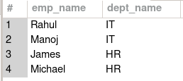

#### Question-1:  Fetch the employees name and the department name they belong to. 
# `department` Table

# `employee` Table

# `manager` table

# `project` table


```sql
-- Inner Join / JOIN
select e.emp_name, d.dept_name
from employee as e 
join department as d on e.dept_id = d.dept_id;
```
![[Pasted image 20251220103918.png]]
